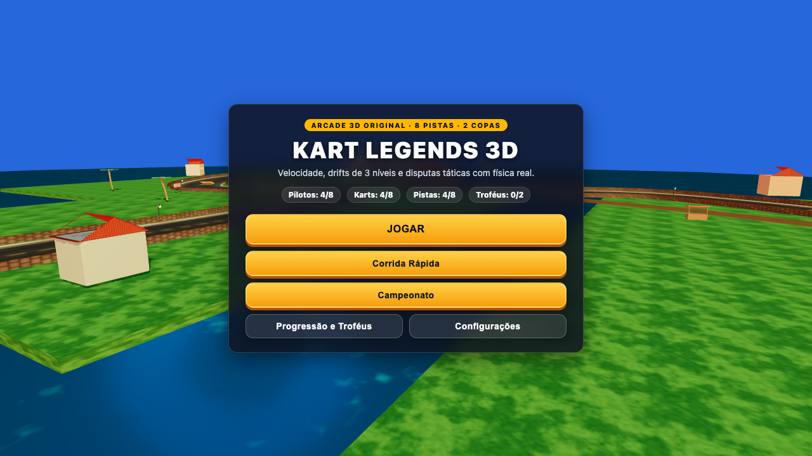
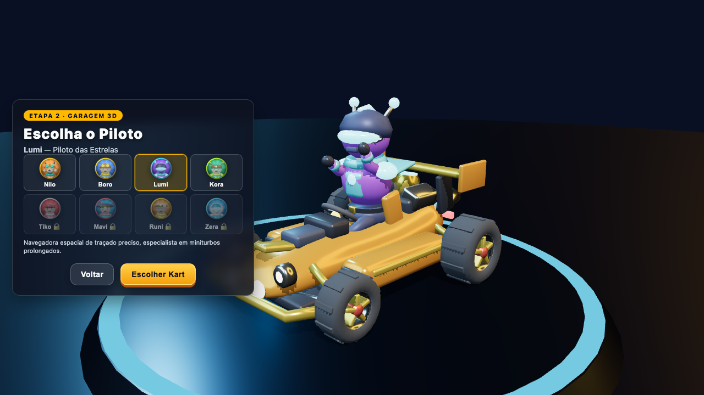
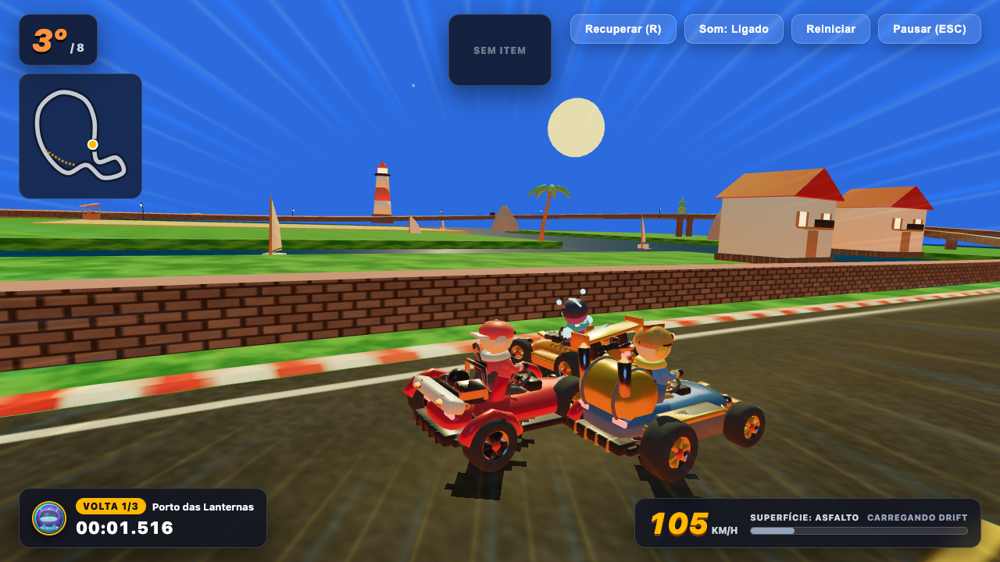
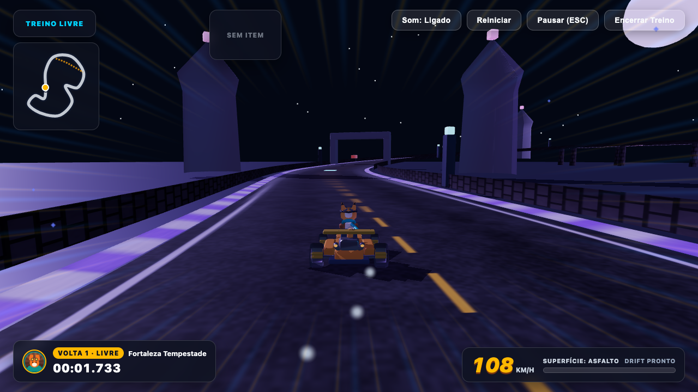
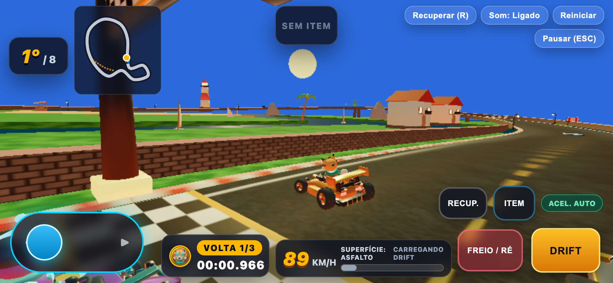

# KART LEGENDS 3D

Jogo original de corrida de kart arcade 3D para navegador, desenvolvido com **React 19**, **TypeScript (`strict`)**, **Three.js / React Three Fiber**, **Rapier Physics**, **Zustand**, **Howler.js + Web Audio API**, **Vitest** e **Playwright**.

> **Status Atual:** Slices 0 a 8 implementados e verificados (8 personagens originais animados, 8 karts estruturalmente distintos, 8 pistas em 2 copas, 7 adversários com IA física, 6 itens, 4 modos de jogo, 14 telas em português-BR, Pódio 3D, save versionado `v1`, VFX em pool com shaders customizados, 3 perfis de qualidade, suporte mobile completo para Chrome iOS & Android e 114 ativos locais validados). Consulte a seção **Notas de Ambiente e Limitações Conhecidas** e [QA_REPORT.md](QA_REPORT.md) para detalhes completos das medições e ferramentas do host.

## Jogar no GitHub Pages

O build de produção publicado fica em **https://jardelkuhnen.github.io/kart3d/**.

O deploy sai do workflow [`.github/workflows/pages.yml`](.github/workflows/pages.yml) a cada push em `main`: `npm ci` e `npm run build` com `BASE_PATH=/kart3d/`, depois `actions/upload-pages-artifact` e `actions/deploy-pages` publicam a pasta `dist`. Os ativos em `public/assets/` (GLB, PNG, OGG, MP3 e `manifest.json`) já estão commitados, então o workflow não executa `npm run assets:build` e não precisa de `ffmpeg`.

Em **Settings → Pages → Build and deployment**, o campo **Source** precisa ser **GitHub Actions**. A opção *Deploy from a branch* (`main` / raiz) serve o `index.html` de desenvolvimento e o jogo abre em branco.

`npm run dev` e `npm run preview` continuam na raiz `/` local. Para reproduzir o subcaminho do Pages:

```bash
BASE_PATH=/kart3d/ npm run build
BASE_PATH=/kart3d/ npm run preview
```

Abra `http://127.0.0.1:4173/kart3d/`.

---

## Capturas Reais de Gameplay (Playwright + Chrome Metal WebGL)

Todas as capturas abaixo foram geradas diretamente pelos testes reais [e2e/performance-vfx.spec.ts](e2e/performance-vfx.spec.ts) e [e2e/mobile-touch.spec.ts](e2e/mobile-touch.spec.ts) no build de produção servido via `vite preview`:

| Tela | Captura |
| :--- | :--- |
| Menu Principal (cenário 3D ao vivo) |  |
| Garagem 3D Showcase (pedestal giratório) |  |
| Corrida em Porto das Lanternas (Copa Aurora) |  |
| Treino em Fortaleza Tempestade (Copa Eclipse + VFX) |  |
| Corrida Mobile em Paisagem (`844×390`, Controles Multitoque) |  |

---

## Funcionalidades Implementadas

- **8 Personagens Originais (`src/data/characters.ts`):** *Nilo*, *Boro*, *Lumi*, *Kora*, *Tiko*, *Mavi*, *Runi* e *Zera*, com modelos GLB próprios, esqueletos articulados, 9 clipes de animação GLTF e retratos/ícones dedicados.
- **8 Karts Distintos (`src/data/karts.ts`):** *Trilha Raposa*, *Engrenagem Turbo*, *Cometa Estelar*, *Raiz Veloz*, *Chave-Mestra GT*, *Brisa Corsária*, *Escorpião Dourado* e *Lâmina Glacial*, diferenciados em geometria GLB e atributos físicos (velocidade, aceleração, curva, drift, peso/colisão e aderência).
- **8 Pistas Detalhadas em 2 Copas:**
  - **Copa Aurora:** *Porto das Lanternas*, *Bosque de Cristal*, *Vale dos Moinhos*, *Cânion Solar*.
  - **Copa Eclipse:** *Cidade Neon*, *Pico Boreal* (piso de gelo com menor aderência), *Jardim Celeste*, *Fortaleza Tempestade* (relâmpagos e obstáculos móveis).
- **Física Arcade + Drift 3 Níveis + Colisões (`kartController.ts`):** Simulação em timestep fixo `60 Hz`, 5 superfícies (`asphalt`, `dirt`, `grass`, `sand`, `ice`), salto, drift carregável em 3 níveis de faíscas com miniturbo ao soltar, rampas, pads de impulso e checkpoints sequenciais anti-corte.
- **7 Adversários IA + 6 Itens (`aiController.ts`, `itemSystem.ts`):** IA física competindo sem teleporte em 3 dificuldades (*Fácil*, *Normal*, *Difícil*) + *Pulso Solar*, *Bolha Guardiã*, *Névoa Prisma*, *Faísca Rastreadora*, *Onda de Vento* e *Cristal de Salto*.
- **14 Telas & 4 Modos (`pt-BR`):** *Corrida Rápida*, *Campeonato* (4 etapas com pontuação acumulada e Cerimônia do Pódio 3D), *Contrarrelógio* e *Treino Livre* (acesso livre às 2 copas e todos os pilotos/karts), mais Garagem Showcase 3D, Configurações (qualidade `Baixo` / `Médio` / `Alto`, 3 volumes, sensibilidade, zona morta e remapeamento de teclas) e Progressão/Troféus com persistência versionada e recuperação contra corrupção (`kart-legends-3d:save:v1`).
- **VFX em Pool & Shaders Customizados:** Sistema de partículas em `InstancedMesh` usando `public/assets/vfx/particles_atlas.png` + `src/shaders/particleAtlasShader.ts` (recorte por quadrante via `aCellOffset` sem alocação por quadro) e `src/shaders/speedLinesShader.ts` (linhas de velocidade radiais).
- **Áudio Integrado Dual-Formato:** 5 músicas, 8 ambiências e 13 SFX em `.ogg` + `.mp3` fallback iOS/Safari (Howler.js `src: [ogg, mp3]`) + sintetizador Web Audio contínuo de motor e chiado de drift com desbloqueio automático no primeiro toque.
- **Suporte Mobile (Chrome iOS & Android):** Detecção automática de tela touch e viewport mobile com qualidade inicial **Baixa**, teto `dpr <= 1.5`, controles multitoque (`PointerEvent.pointerId`) no componente `TouchControls.tsx` (pad de direção à esquerda + Drift, Item, Freio/Ré e Recuperar à direita + Aceleração Automática opcional), alternância manual `Auto` / `Ligado` / `Desligado` nas Configurações, layout paisagem responsivo com `100dvh`, `viewport-fit=cover`, `env(safe-area-inset-*)`, prevenção de callout iOS (`-webkit-touch-callout: none`) e `manifest.webmanifest`.

---

## Requisitos de Ambiente

- **Node.js 22+** (`v26.7.0` validado neste host)
- **npm 10+** (`12.0.2` validado neste host)
- **`ffmpeg`** (`8.1.1` validado — transcodificação `.ogg`/`libopus` + `.mp3`/`libmp3lame` durante `npm run assets:build`)
- **Google Chrome** (para execução da suíte Playwright E2E com WebGL GPU)

---

## Instalação e Execução Local

```bash
npm install
npm run assets:build
npm run validate:assets
npm run dev
```

Abra o endereço local exibido pelo Vite no navegador (não exige chaves de API nem acesso externo à internet). Para testar o pacote otimizado de produção localmente na porta `4173`:

```bash
npm run build
npm run preview
```

---

## Controles na Pista

- `W` / `Seta Cima`: Acelerar *(remapeável nas Configurações)*
- `S` / `Seta Baixo`: Frear / Marcha à ré *(remapeável)*
- `A` / `D` ou `Setas Esquerda/Direita`: Virar *(remapeável)*
- `Espaço`: Saltar / Iniciar e carregar Drift (Níveis 1, 2 e 3 com Miniturbo ao soltar) *(remapeável)*
- `Shift`: Utilizar item equipado *(remapeável)*
- `R`: Recuperar kart no último checkpoint válido *(remapeável)*
- `Esc`: Pausar / Retomar
- Suporte completo à **Gamepad API** (direcional analógico/D-pad, gatilhos e botões de drift/item/pausa) com sensibilidade e zona morta ajustáveis.
- **Controles Touch Mobile (`TouchControls`):** Pad horizontal deslizante de direção à esquerda + botões independentes à direita (**Drift**, **Item**, **Freio/Ré**, **Recuperar** e **Aceleração** quando o modo de aceleração automática está em *Manual*), exibidos automaticamente em dispositivos touch ou configuráveis via **Configurações → Controles Touch (Mobile)**.

---

## Comandos Obrigatórios Disponíveis

- `npm install` — Instala todas as dependências do projeto.
- `npm run dev` — Inicia o servidor de desenvolvimento Vite.
- `npm run build` — Executa `tsc --noEmit` e gera o build de produção em `dist/` (base `/`, a menos que `BASE_PATH` esteja definido).
- `npm run preview` — Sobe o build de produção localmente na porta `4173`. Com `BASE_PATH=/kart3d/` no build e no preview, o jogo fica em `http://127.0.0.1:4173/kart3d/`.
- `npm run typecheck` — Verificação estrita de tipos TypeScript.
- `npm run lint` — Análise estática com ESLint.
- `npm run test` — Executa os testes unitários no Vitest.
- `npm run test:e2e` — Executa os testes ponta a ponta e captura/benchmark no Playwright (Chrome + WebGL).
- `npm run assets:build` — Gera os 114 ativos locais (GLB, PNG, OGG e MP3 fallback) e atualiza `public/assets/manifest.json` e `ASSET_MANIFEST.md`.
- `npm run validate:assets` — Audita todos os arquivos em `public/assets/` contra o manifesto, checando assinaturas GLB/PNG/OGG/MP3, fallback MP3 obrigatório, licenças, nós/animações obrigatórios e ausência de arquivos órfãos.

---

## Notas de Ambiente e Limitações Conhecidas

- **Ausência de `blender` CLI no host:** `blender` não estava instalado neste ambiente macOS; por isso, todos os modelos GLB, esqueletos, animações GLTF, texturas PNG, retratos, atlas VFX e áudios OGG foram produzidos de forma 100% original e determinística pelo pipeline TypeScript do repositório (`@gltf-transform/core`, `pngjs` e `ffmpeg 8.1.1`) e auditados em `npm run validate:assets`. Caso seja necessária substituição futura por esculturas modeladas em Blender, o pipeline de importação/manifesto já valida exatamente o mesmo contrato GLB.
- **Desempenho Medido:** Em `e2e/performance-vfx.spec.ts` (headless Chrome + ANGLE Metal GPU, 1280×720, *Porto das Lanternas*, 8 karts com VFX ativo em drift), foram medidos entre **52,5 FPS e 54,1 FPS médios** (P95 `33,3 ms/quadro`, mínimo pontual `15,0–29,9 FPS`, heap JS `64,8–75,5 MB` entre execuções). Em equipamentos menos potentes, recomenda-se selecionar o perfil de qualidade **Baixo** ou **Médio** em Configurações.
- **Cobertura de Conclusão de Corrida (3 Voltas):** A validação de cruzamento sequencial das 3 voltas, cálculo completo de pontos do campeonato e atribuição de troféus é verificada de maneira determinística no Vitest (`src/tests/racing.test.ts` e `src/tests/save-championship.test.ts`), enquanto o Playwright valida em navegador real WebGL o fluxo de menus, persistência/corrupção de save, seletores, corrida ativa com 8 competidores, física/drift, áudio, pausa e benchmark de VFX.

---

## Documentação Complementar

- Arquitetura: [docs/ARCHITECTURE.md](docs/ARCHITECTURE.md)
- Manifesto de Assets: [ASSET_MANIFEST.md](ASSET_MANIFEST.md)
- Licenças: [LICENSES.md](LICENSES.md)
- Relatório de QA: [QA_REPORT.md](QA_REPORT.md)
